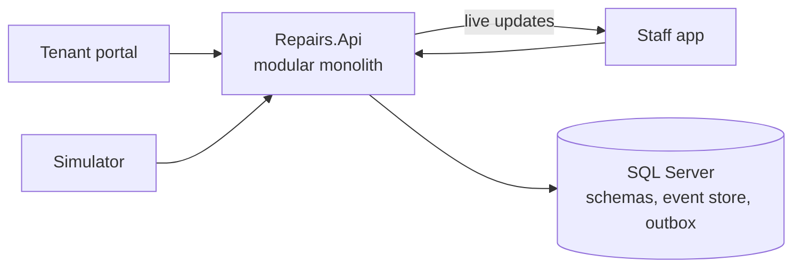

# Property Compliance Platform

An event-driven, domain-driven reference platform in **.NET and React** for **social housing hazard compliance**
under **Awaab's Law**: the statutory deadlines for investigating and fixing hazards like damp and mould
in social homes in England.

> **Status: design complete; Phase 0 next.** See the roadmap below.
> This is a portfolio and learning project. The legal model is simplified and is not legal advice.

## Why this domain

Awaab's Law turns regulation into time-critical, event-driven business rules:

- **Statutory clocks**: 24 clock hours for emergencies, 10 working days to investigate, 3 working days for a
  written summary, 5 working days to make safe, with restarts and stops triggered by events.
- **A legal audit trail**: what the landlord knew and when becomes evidence in court, so the hazard case is event-sourced.
- **Regulation that changes by phase**: new hazard types from 30 November 2026, modelled as dated policies, not rewrites.

## Architecture at a glance

- **Modular monolith** in ASP.NET Core: six bounded contexts (Tenancies, Repairs, Hazard Compliance, Contractors,
  Communications, Oversight), each with its own schema, talking only through integration events.
- **Wolverine** transactional outbox and inbox on SQL Server; **hand-rolled event store** on EF Core for the hazard case.
- **CQRS** read models pushed live to the staff dashboard with SignalR.
- **Two React + TypeScript apps**: a public tenant portal and an internal staff app.
- **Simulator** that plays tenants, investigators and contractors on an accelerated clock.
- **Azure at £0**: Container Apps (scale to zero), Azure SQL free offer, Static Web Apps; infrastructure in **Terraform**.

Full design: [docs/design.md](docs/design.md) · Diagrams: [docs/diagrams.md](docs/diagrams.md)

## Roadmap

- [ ] **0. Foundations**: solution structure, Aspire, CI, architecture tests, ADRs
- [ ] **1. Repairs core**: concern intake, triage, work orders; tenant portal and staff app
- [ ] **2. Hazard compliance**: event-sourced hazard case, statutory clocks, deadline sweeper, written summaries, rehousing
- [ ] **3. Contractors and messaging hardening**: no-access flows, idempotency, retries, dead-lettering
- [ ] **4. Oversight and simulator**: live dashboard, projection rebuilds, scenario playback
- [ ] **5. Azure**: Terraform, GitHub Actions deploy and teardown, Application Insights

## Tech stack

.NET 10 · ASP.NET Core · EF Core · SQL Server / Azure SQL · Wolverine · Aspire · React · TypeScript · Vite ·
TanStack Query · SignalR · xUnit · Testcontainers · Terraform · GitHub Actions · Azure Container Apps

## Licence

[MIT](LICENSE)
