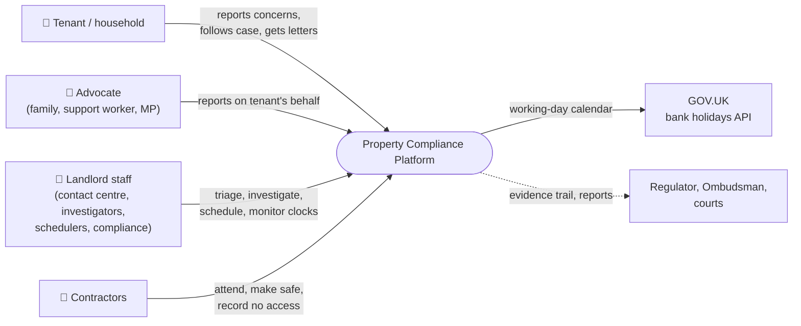
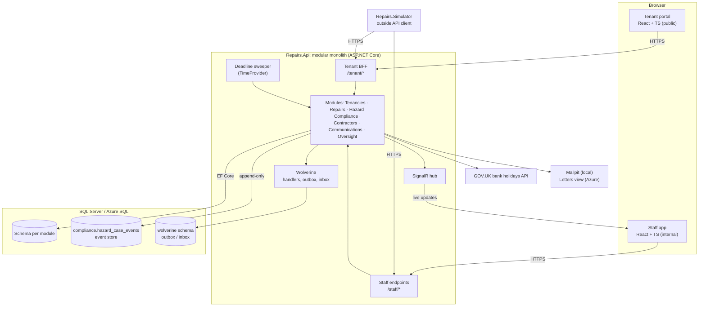
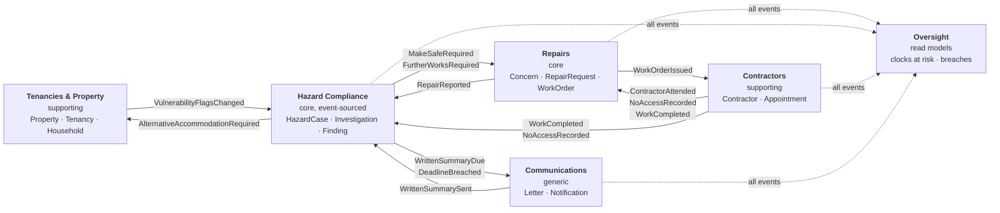
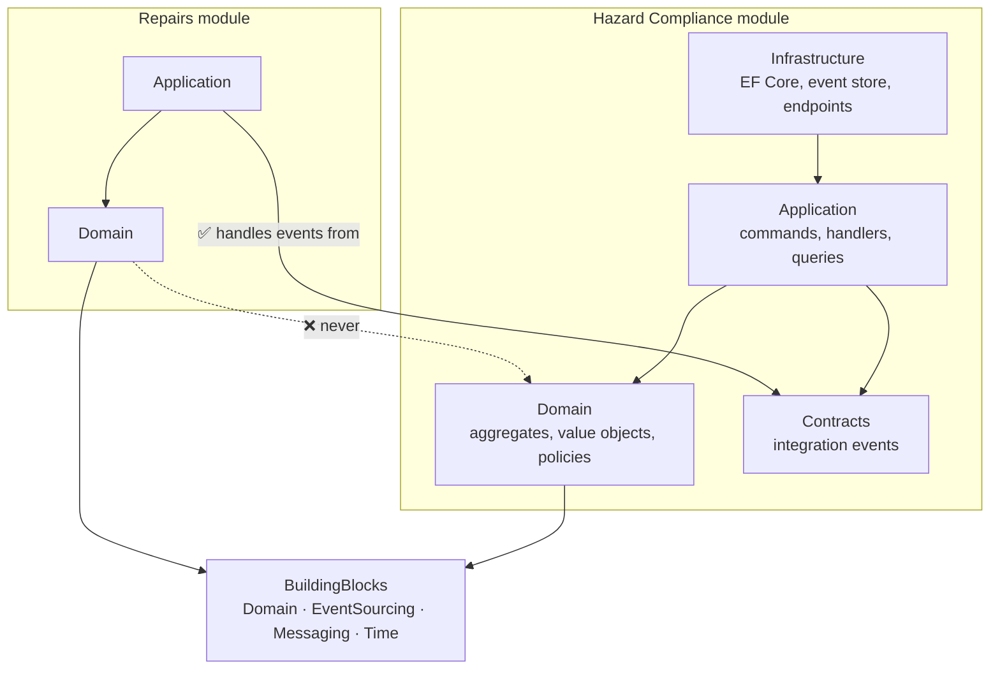
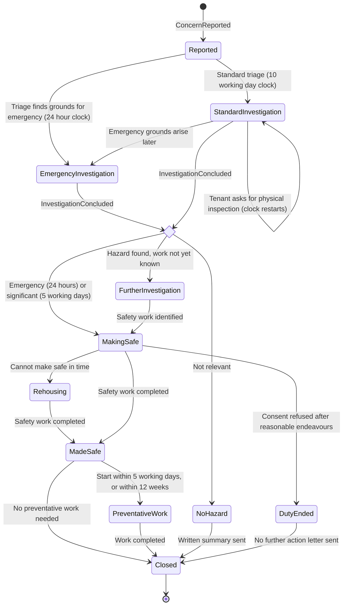
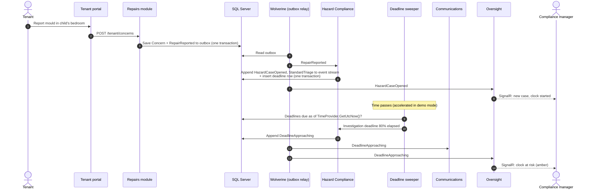
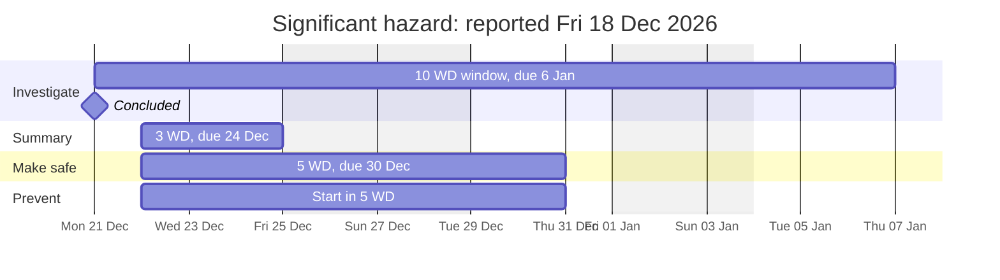
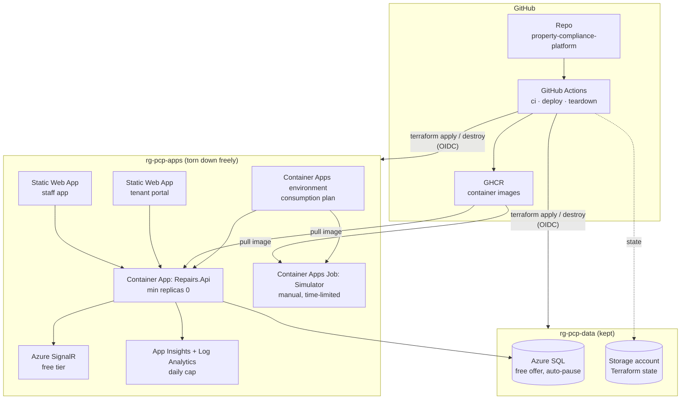

# Diagrams

Visual overview of what we're building. Details and reasoning are in [design.md](design.md).

1. [System context](#1-system-context)
2. [Runtime containers](#2-runtime-containers)
3. [Bounded contexts and integration events](#3-bounded-contexts-and-integration-events)
4. [Module dependency rules](#4-module-dependency-rules)
5. [Hazard case lifecycle](#5-hazard-case-lifecycle)
6. [A concern from report to dashboard](#6-a-concern-from-report-to-dashboard)
7. [Statutory clocks: a worked example](#7-statutory-clocks-a-worked-example)
8. [Azure deployment at £0](#8-azure-deployment-at-0)

---

## 1. System context

Who uses the platform and what it talks to.

---

## 2. Runtime containers

What actually runs. Locally everything starts with Aspire; in Azure each box maps to a free-tier service.

---

## 3. Bounded contexts and integration events

Each context owns its data and schema. Contexts talk only through integration events published via the outbox.

---

## 4. Module dependency rules

Inside a module, dependencies point inwards to the domain. Between modules, only `Contracts` may be referenced.
Architecture tests fail the build if these rules are broken.

---

## 5. Hazard case lifecycle

The `HazardCase` process manager, simplified. Every transition is an event in the case's stream.
The written summary (3 working days after any investigation) and tenant updates run alongside these states.

---

## 6. A concern from report to dashboard

How one damp report flows through the modules. The state change and its outgoing messages always commit
in **one transaction** (the outbox), so nothing is lost if the process crashes.

---

## 7. Statutory clocks: a worked example

A significant damp hazard reported on **Friday 18 December 2026**, with the investigation concluded on
**Monday 21 December**. Working days skip weekends, Christmas Day, the Boxing Day substitute (Mon 28 Dec)
and New Year's Day (WD = working days). This is the case the `StatutoryPeriod` tests are built around.
If preventative work can't start within 5 working days, it must start within 12 weeks (by Mon 15 Mar 2027).

---

## 8. Azure deployment at £0

Two resource groups so tearing down the apps can never touch the data. GitHub Actions deploys with Terraform
and signs in to Azure with OIDC, so no secrets are stored.

