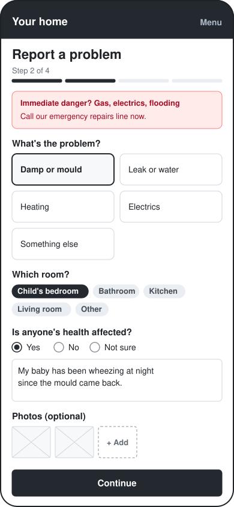
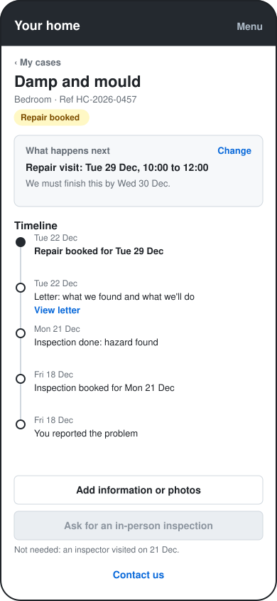
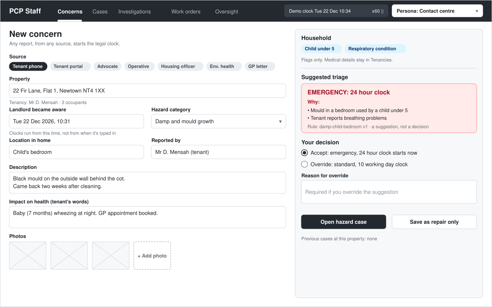
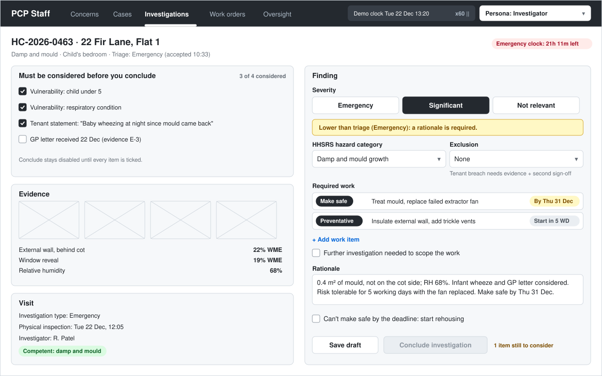
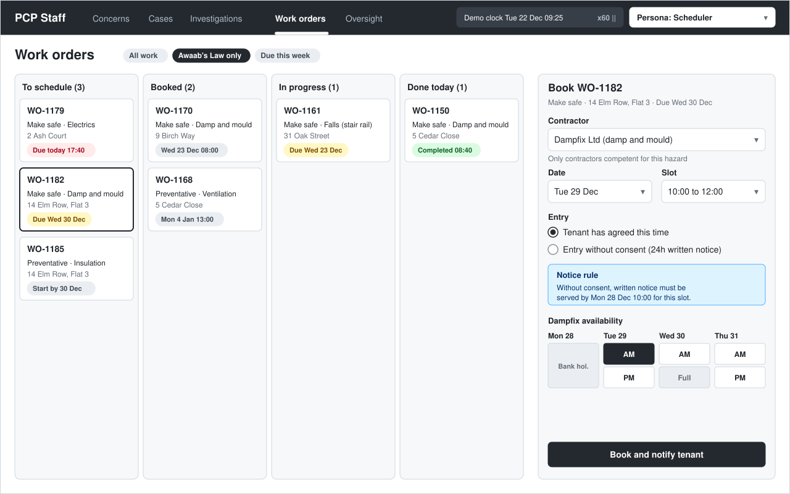
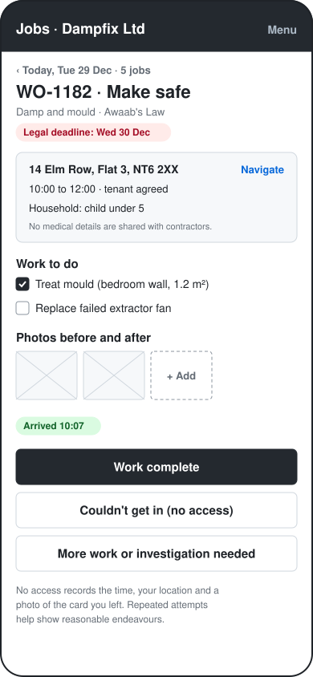
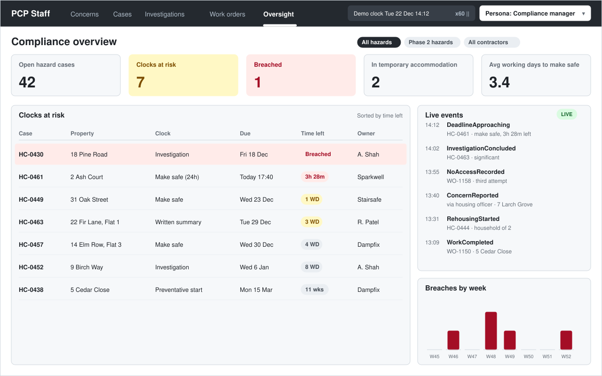
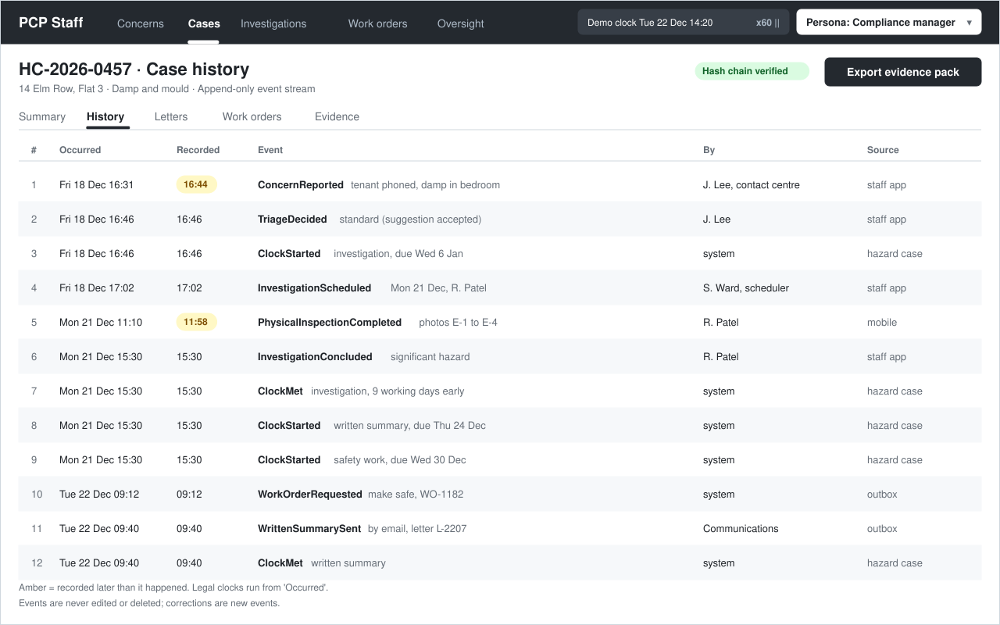

# UI wireframes

Low-fidelity wireframes: they show **layout, content and the domain rules each screen enforces**,
not visual design. One screen per v1 persona, plus the oversight dashboard and the legal case history.
Design reasoning is in [design.md](design.md); diagrams are in [diagrams.md](diagrams.md).

The SVGs are generated by [wireframes/generate.py](wireframes/generate.py) (standard library only).
To change a screen, edit its function and run:

```
python docs/wireframes/generate.py
```

## The story across the screens

The screens follow two example cases, so dates and deadlines are consistent from screen to screen.
They match the worked example in [diagrams.md](diagrams.md#7-gantt-chart-statutory-clocks-worked-example).

| Case | Property | What happens |
|---|---|---|
| **HC-2026-0457** | 14 Elm Row, Flat 3 | Reported Fri 18 Dec, standard triage, inspected Mon 21 Dec, **significant** hazard. Written summary sent Tue 22 Dec; make-safe visit booked for Tue 29 Dec, deadline Wed 30 Dec. |
| **HC-2026-0463** | 22 Fir Lane, Flat 1 | Reported Tue 22 Dec 10:31, system suggests **emergency** (child under 5, breathing problems), operator accepts. The investigator later finds it **significant**, which forces a written rationale. |

| # | Screen | Persona | App |
|---|---|---|---|
| 1 | [Report a problem](#1-tenant-report-a-problem) | Tenant | Tenant portal (mobile) |
| 2 | [Case timeline](#2-tenant-case-timeline) | Tenant | Tenant portal (mobile) |
| 3 | [Concern intake and triage](#3-contact-centre-concern-intake-and-triage) | Contact centre | Staff app |
| 4 | [Record a finding](#4-investigator-record-a-finding) | Investigator | Staff app |
| 5 | [Work orders and booking](#5-scheduler-work-orders-and-booking) | Scheduler | Staff app |
| 6 | [Job card](#6-contractor-job-card) | Contractor | Staff app, contractor area (mobile) |
| 7 | [Compliance overview](#7-compliance-manager-compliance-overview) | Compliance manager | Staff app |
| 8 | [Case history](#8-compliance-manager-case-history) | Compliance manager | Staff app |

Staff screens share a header with a **demo clock** (the accelerated `TimeProvider`, with speed and pause)
and a **persona switcher** in place of real sign-in for the demo.

---

## 1. Tenant: report a problem



- **Immediate-danger banner first**, so emergencies go to the phone line, not a form.
- **Health impact in the tenant's own words.** The investigator must consider this before concluding (reg 6(3)(d)).
- Plain English, large tap targets, mobile first.

## 2. Tenant: case timeline



- **"What happens next"** with the legal deadline, written for the tenant.
- The timeline is a tenant-friendly **projection of the case's events**, newest first.
- The written summary letter is linked from the timeline.
- **"Ask for an in-person inspection"** is the tenant's right that restarts the investigation clock (regs 6 and 7).
  It's disabled here because a physical inspection already happened.

## 3. Contact centre: concern intake and triage



- **Source** covers every route by which the landlord "becomes aware": tenant, advocate, operative,
  housing officer, environmental health, GP letter.
- **"Landlord became aware"** is entered separately from the time it's typed in, because legal clocks run from it.
- **Vulnerability flags only.** Medical details stay in the Tenancies context.
- **Suggested triage** with its reasons and the rule that produced it. A person accepts or overrides it,
  and an override needs a reason.

## 4. Investigator: record a finding



- **Must be considered:** every vulnerability flag and tenant statement has to be ticked before
  **Conclude** is enabled.
- **Downgrade from triage** (Emergency → Significant) shows a warning and makes the rationale mandatory.
- **Competence** for the hazard category is shown and checked.
- **Exclusion** for tenant breach needs evidence and a second sign-off.
- **Required work** is split into make-safe and preventative, each with its statutory deadline.
- **Rehousing** is one tick away when the home can't be made safe in time.

## 5. Scheduler: work orders and booking



- Board of work orders, filtered to Awaab's Law work, with deadline chips coloured by urgency.
- **Only competent contractors** are offered for the hazard type.
- **Entry rule:** entry without consent needs 24 hours' written notice (reg 20). The panel works out the notice
  deadline for the chosen slot.
- Availability marks the **bank holiday** (Mon 28 Dec 2026), which also doesn't count as a working day.

## 6. Contractor: job card



- Legal deadline at the top, so contractors know the work is time-critical.
- Household flag ("child under 5") without medical details.
- **No access** is a first-class outcome: it records time, location and a photo, which builds the
  landlord's evidence of reasonable endeavours.
- "More work or investigation needed" feeds a further investigation (reg 8).

## 7. Compliance manager: compliance overview



- KPI tiles: open cases, clocks at risk, breaches, households in temporary accommodation, average time to make safe.
- **Clocks at risk** comes straight from the deadline table, sorted by time left. Breaches are highlighted.
- **Live events** are pushed over SignalR as integration events happen.
- Filter for **Phase 2 hazards** (from 30 November 2026), which shows the dated policy at work.

## 8. Compliance manager: case history



- The case's **append-only event stream**, shown as the legal record.
- **Occurred vs recorded** times, with late entries highlighted: clocks run from when it happened.
- **Hash chain verified** shows the history hasn't been tampered with.
- **Export evidence pack** for complaints, the Ombudsman or court.
